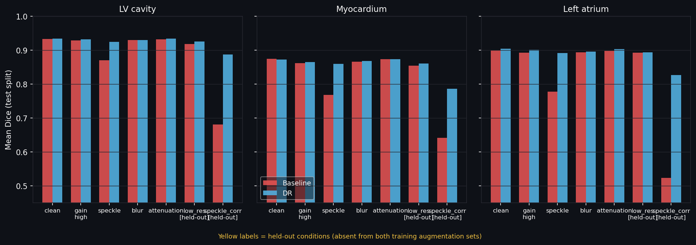

# Echocardiogram Segmentation on CAMUS

2D segmentation of LV cavity, myocardium, and left atrium on apical echocardiograms from the [CAMUS](https://www.creatis.insa-lyon.fr/Challenge/camus/) dataset. Emphasis on leak-free evaluation, patient-level confidence intervals, stratified failure analysis, and robustness to acquisition-domain shift.

> Research and demonstration only. Not a medical device.

## Results

Bootstrap 95% CIs over 1 000 resamples (patient-level test split, n=75 patients).

| Structure | Dice (95% CI) | HD95 mm (95% CI) |
|-----------|--------------|-----------------|
| LV cavity | 0.933 (0.929–0.938) | 1.65 (1.52–1.80) |
| Myocardium | 0.874 (0.869–0.880) | 1.73 (1.61–1.87) |
| Left atrium | 0.899 (0.889–0.908) | 2.16 (1.94–2.39) |

**Provenance.** The baseline checkpoint dates from 28 Oct 2026; the reason for the retrain was not recorded. Val and test were both evaluated that day, before the robustness study. All robustness-study design decisions (corruptions, severities, DR ranges) were made using the validation split only.

## Setup

```bash
# 1. Create environment
python -m venv .venv && source .venv/bin/activate

# 2. Install (CPU-only torch for dev; use GPU wheel for training)
pip install torch torchvision --index-url https://download.pytorch.org/whl/cu121  # GPU
pip install -e ".[dev]"
```

## Data

Download CAMUS from the [Human Heart Project](https://www.creatis.insa-lyon.fr/Challenge/camus/databases.html). Place under `data/CAMUS_public/` so the structure is:

```
data/CAMUS_public/
  patient0001/
    patient0001_2CH_ED.mhd
    patient0001_2CH_ED_gt.mhd
    ...
```

Update `configs/default.yaml → data.root` if your path differs.

## Reproduce

```bash
# Check data integrity
python scripts/00_verify_data.py

# Build patient-level split (runs leak test automatically)
python scripts/01_prepare_split.py

# Train baseline
python scripts/02_train.py --run-name baseline

# Evaluate on validation split (development)
python scripts/03_evaluate.py --checkpoint models.nosync/baseline/best.pth --split val

# Train remaining ensemble members (see note below)
python scripts/04_train_ensemble.py

# Uncertainty analysis (see note below)
python scripts/05_uncertainty.py

# Evaluate on test split — open once, after configuration is locked
python scripts/03_evaluate.py --checkpoint models.nosync/baseline/best.pth --split test

# Export to ONNX + parity check
python scripts/06_export_onnx.py --checkpoint models.nosync/baseline/best.pth
```

See `learning/RUNBOOK.md` for a step-by-step guide with expected outputs.

**Ensemble and uncertainty results** were produced from an Oct 26 training run. The ensemble checkpoint weights (`models.nosync/ensemble_0{0–4}/best.pth`) are no longer on disk and may predate the Oct 28 split re-run. Uncertainty results (`results/val_uncertainty.csv`, `results/test_uncertainty.csv`) do not exist. Re-run `04_train_ensemble.py` and `05_uncertainty.py` if needed.

## Tests

```bash
pytest
```

## Robustness to acquisition variability

### Motivation

Ultrasound images vary substantially across acquisitions: gain settings, depth, scanner frequency,
and tissue properties all affect the intensity distribution. A model trained on a single centre may
fail silently when any of these change. Standard augmentation (affine, gamma, Gaussian noise) does
not systematically cover physics-driven shifts such as speckle, PSF blur, and depth attenuation.

This section asks whether augmenting with physics-inspired appearance randomisation improves
robustness to such shifts.

### Method

The baseline (trained with standard augmentation) is compared against a DR arm (trained with
physics-inspired augmentation: Rayleigh speckle, anisotropic blur, depth-attenuation ramp,
wider gain range). Both use the same architecture, seed, and 100-epoch budget.

Seven test-time conditions are applied to the **held-out test split**:

| Condition | In DR training | Description |
|-----------|---------------|-------------|
| clean | — | unmodified images |
| gain\_high | yes | uniform ×1.5 gain, clipped |
| speckle | yes | multiplicative Rayleigh noise (mean≈1, std≈0.47); spatially i.i.d. |
| blur | yes | anisotropic Gaussian PSF (axial σ=2 px, lateral σ=1 px) |
| attenuation | yes | depth-linear gain ramp (1.2 → 0.5) |
| low\_res | **no** | ×4 downsample/upsample (64 px effective) |
| speckle\_corr | **no** | spatially correlated speckle via complex Gaussian envelope (σ=1.5 px, multiplier std≈0.30) |

`low_res` and `speckle_corr` are held out: they appear in neither arm's training augmentation.
Any improvement there is not by construction. The CAMUS image-quality tiers (good/medium/poor)
provide a further unplanned natural shift.

### Results

Mean Dice on the held-out test split. 95% CIs are patient-level bootstrap (1 000 resamples, patients
resampled as units). CIs reflect test-case sampling; one training seed was used per arm.

| Condition | Baseline LV | DR LV | Baseline Myo | DR Myo | Baseline LA | DR LA |
|-----------|-------------|-------|--------------|--------|-------------|-------|
| clean | 0.933 (0.929–0.938) | 0.934 (0.930–0.939) | 0.874 (0.869–0.880) | 0.872 (0.866–0.878) | 0.899 (0.889–0.908) | 0.904 (0.895–0.912) |
| gain\_high | 0.928 (0.923–0.932) | 0.932 (0.927–0.937) | 0.862 (0.855–0.869) | 0.865 (0.859–0.872) | 0.892 (0.881–0.902) | 0.901 (0.890–0.910) |
| speckle | 0.870 (0.850–0.888) | 0.924 (0.917–0.930) | 0.768 (0.749–0.785) | 0.859 (0.852–0.865) | 0.778 (0.746–0.806) | 0.891 (0.879–0.902) |
| blur | 0.930 (0.924–0.935) | 0.930 (0.924–0.936) | 0.866 (0.860–0.873) | 0.868 (0.861–0.874) | 0.893 (0.881–0.903) | 0.896 (0.885–0.907) |
| attenuation | 0.932 (0.927–0.937) | 0.934 (0.930–0.939) | 0.873 (0.867–0.878) | 0.873 (0.867–0.879) | 0.898 (0.889–0.907) | 0.903 (0.894–0.911) |
| **low\_res** | 0.918 (0.912–0.924) | 0.925 (0.917–0.932) | 0.854 (0.848–0.861) | 0.861 (0.853–0.868) | 0.892 (0.882–0.902) | 0.893 (0.881–0.905) |
| **speckle\_corr** | 0.681 (0.649–0.710) | 0.887 (0.878–0.895) | 0.641 (0.616–0.663) | 0.786 (0.774–0.797) | 0.524 (0.484–0.564) | 0.826 (0.805–0.844) |

Bold rows are held-out conditions (absent from both training augmentation sets). Full per-case CSVs
and bootstrap draws are in `results/shift_baseline_test_summary.json` and
`results/shift_dr_test_summary.json`.

**Note on interpretation:** the baseline is robust to blur, attenuation, gain, and low-resolution
conditions; differences versus the DR arm on those conditions are below 0.01 Dice and are not
claimed here. The held-out `low_res` condition shows no clear DR gain: Δ LV +0.007
(CI −0.001 to +0.014), Myo +0.006 (CI 0.000 to +0.012), LA +0.001; all CIs include or
nearly include zero. Uncorrelated speckle (`speckle`) degrades the baseline substantially (LV −0.06,
Myo −0.11, LA −0.12 versus clean); the DR augmentation set (Rayleigh speckle, anisotropic blur,
depth-attenuation ramp, wider gain/gamma range) closes this gap. `speckle_corr` is spatially
correlated speckle of similar amplitude, not used in training by either arm; the baseline drops
sharply (LV −0.25, Myo −0.23, LA −0.37 versus clean) and the DR arm retains higher Dice on this
condition (LV +0.21, Myo +0.14, LA +0.30). This result is not by construction, but the
interpretation is limited by the factors below.

**Limitations of this study:** corruptions are synthetic and applied to a single-centre dataset;
no real cross-device images were used. One training seed was used per arm, so arm differences
cannot be separated from run-to-run variance. Differences smaller than 0.01 Dice are not
reported as findings.

### Reproducing the robustness study

```bash
# 1. Evaluate baseline across all shift conditions (val, then test once locked)
python scripts/09_robustness.py \
    --checkpoint models.nosync/baseline/best.pth \
    --model-name baseline --split val

# 2. Train DR arm (same seed and budget as baseline)
python scripts/08_train_dr.py --config configs/dr.yaml --run-name dr

# 3. Evaluate DR arm
python scripts/09_robustness.py \
    --checkpoint models.nosync/dr/best.pth \
    --model-name dr --split val

# 4. Open test split only once, after configuration is locked
python scripts/09_robustness.py \
    --checkpoint models.nosync/baseline/best.pth \
    --model-name baseline --split test
python scripts/09_robustness.py \
    --checkpoint models.nosync/dr/best.pth \
    --model-name dr --split test

# 5. Explore results
jupyter notebook notebooks/04_robustness_analysis.ipynb
```

---

## Demo

Run `streamlit run app.py`. Upload a grayscale apical echo frame, select a corruption condition from the sidebar, and compare baseline vs DR segmentation side by side. The study results are in the tables above. The app is a qualitative demo: models were trained on CAMUS only, and segmentations may be poor on images unlike CAMUS (for example synthetic or non-echo images).

**Note:** the app requires ONNX model files, which are not committed to this repository (`.onnx` is gitignored). Generate them before running:

Uploaded PNG/JPEG screenshots differ from the NIfTI data used in evaluation (8-bit quantisation, unknown pixel spacing), so the demo is qualitative only.

```bash
python scripts/06_export_onnx.py --checkpoint models.nosync/baseline/best.pth
python scripts/06_export_onnx.py --checkpoint models.nosync/dr/best.pth
```



*Mean Dice on the held-out test split (75 patients). One illustrative example, not a typical case; averages are in the results table.*

### App screenshots

<!-- uncomment after adding docs/screenshot_app_ui.png -->
<!--  -->

<!-- uncomment after adding docs/screenshot_speckle.png -->
<!--  -->

<!-- uncomment after adding docs/screenshot_speckle_corr.png -->
<!--  -->

## Limitations

- Single dataset (one centre, one scanner vendor). Generalisation to other devices is not demonstrated.
- Test set of ~75 patients yields wide confidence intervals; thresholds are stated post-hoc.
- One training seed per arm; arm differences cannot be attributed to augmentation strategy alone.
- Corruptions are synthetic; results on real cross-device images may differ.

## Structure

```
configs/          training and evaluation hyperparameters
src/echo_seg/     installable package
  data/           split, dataset, augmentation
  models/         U-Net factory
  training/       training loop
  evaluation/     metrics, bootstrap CIs, stratified analysis
  uncertainty/    ensemble inference, risk-coverage
scripts/          00–06 execution scripts (in order)
tests/            pytest tests (split leak, metrics, augmentation)
```

## Citation

CAMUS dataset (CC BY-NC-SA 4.0):

```
S. Leclerc, E. Smistad, J. Pedrosa, A. Ostvik, et al.
"Deep Learning for Segmentation using an Open Large-Scale Dataset in 2D
Echocardiography" in IEEE Transactions on Medical Imaging, vol. 38, no. 9,
pp. 2198-2210, Sept. 2019.
doi: 10.1109/TMI.2019.2900516
```

---

*Portfolio project by [Khayala Gaybaliyeva](https://linkedin.com/in/khayala-gaybaliyeva) — ResNet34 U-Net segmentation on CAMUS with physics-inspired domain randomisation and patient-level robustness evaluation.*
